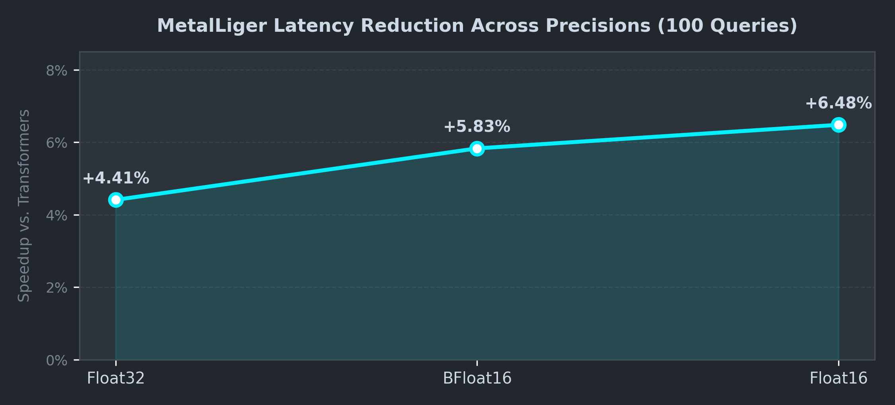

# Metalliger

<p align="center">
  
</p>

<p align="center">
  <strong>Ultra-Fast Native PyTorch LLM & VLM Inference on Apple Silicon</strong>
  <br />
  <em>Zero model conversion. Fused Metal kernels. Faster and Better accuracy.</em>
</p>

<p align="center">
  
  
  
  
</p>

---

## Overview

**MetalLiger** brings Liger Kernel-style operator fusion, Flash Attention, and zero-allocation static KV caching to Apple's Metal Performance Shaders (MPS) backend.

Running LLMs and Vision-Language Models (VLMs) on Apple Silicon has traditionally forced developers into a trade-off:
- MLX / MLX-VLM: Fast, but requires converting weights to a proprietary ecosystem, often altering numerics, breaking PyTorch tooling, and introducing precision drift.
- Vanilla PyTorch MPS: Ecosystem compatibility, but bogged down by Python-to-C++ dispatch overhead, dynamic memory allocations, and fragmented Metal GPU kernels.

**MetalLiger eliminates the compromise.** By running **100% native PyTorch** with fused Metal kernels, pre-allocated static memory buffers, and MPS Flash Attention, MetalLiger outperforms MLX-VLM in autoregressive token generation speed while preserving exact model reasoning quality.

---

## Comparision

### % speedup (time reduction) of Metalliger over Hugging Face Transformers on 100 VQ Queries



Tested on Apple Silicon (**M4 Pro**) with `qwen3_vl` (`madrisight/madrimed1.2-VL-2B`) architecture model:

### 1. Text

| Inference Engine | Data Type | Accuracy | Decode Speed | Prefill Throughput |
| :--- | :--- | :--- | :--- | :--- |
| **transformers** | Float32 | Very High | 27.99 t/s | — |
| **metalliger** | Float32 | Better | 29.90 t/s | 506.7 t/s |
| **transformers** | BFloat16 | Very High | 43.12 t/s | — |
| **metalliger** | BFloat16 | Better | 48.50 t/s | 567.7 t/s |
| **mlx-vlm** | BFloat16 | Average | 35.81 t/s | 699.1 t/s |
| **llama.cpp** | Float16 (GGUF) | Low | 66.90 t/s | 878.2 t/s |

---

### 2. Visual QA 

| Inference Engine | Data Type | Accuracy | Decode Speed | Prefill Throughput |
| :--- | :--- | :--- | :--- | :--- |
| **transformers** | Float32 | Very High | 25.62 t/s | — |
| **metalliger** | Float32 | Better | 29.60 t/s | 525.0 t/s |
| **transformers** | BFloat16 | Average | 38.84 t/s | — |
| **metalliger** | BFloat16 | Average | 47.70 t/s | 732.9 t/s |

---

## Core Engineering

1. **`M4StaticCache` (Zero-Allocation KV Cache)**:
   Standard PyTorch `DynamicCache` calls `torch.cat` on every single token, creating over 12,000 intermediate tensor allocations for a 500-token generation across 24 layers. `M4StaticCache` pre-allocates unified memory buffers once and updates key-values in-place with zero memory copies.
2. **Fused Metal Kernels**:
   Replaces fragmented multi-op Python dispatch with fused Metal shaders:
   - **Fused RMSNorm**: Single-pass root-mean-square normalization.
   - **Fused SwiGLU**: Fast bfloat16 fused GEMM + activation without autograd frame overhead.
   - **Fused RoPE**: Continuous M-RoPE position embedding tracker for multimodal VLMs.
3. **MPS Flash Attention**:
   Direct integration with native Metal Flash Attention kernels (`mps-flash-attention`), reducing memory complexity from $O(N^2)$ to $O(N)$ during prompt prefill.
4. **True Zero-Sync Pipeline Loop**:
   Eliminates per-token GPU synchronization stalls. By batching end-of-sequence checks into single-scalar checks, Metal command buffers flow without pipeline bubbles.
5. **Top-K Guided Nucleus Sampling**:
   Caps sorting overhead to candidate tokens instead of sorting all 152,000 vocabulary logits on every step.

---

## Installation

### 1. Prerequisites
- macOS 14.0+ (Sonoma or Sequoia)
- Apple Silicon Mac (M4 series)
- Python 3.10+

### 2. Quick One-Line Setup for flash attention (Terminal)
```bash
git clone https://github.com/mpsops/mps-flash-attention && pip install -e mps-flash-attention && pip install -e .
```

### 3. Step-by-Step Installation
```bash
!pip install git+https://github.com/krrish-v/metalliger.git
```

---

## Quick Start

### Python API
```python
import torch
from PIL import Image
from metalliger.inference import InferenceEngine

# 1. Initialize the Native Apple Silicon Inference Engine
engine = InferenceEngine(
    model_id="<qwen_3vl_model_path>",
    max_seq_len=4096,
    dtype=torch.float32,
    use_compile=False
)

# 2. Run multimodal vision-language inference
image = Image.open("<image_path>")

prompt = ""

response = engine.generate(
    text_prompt=prompt,
    images=[image],
    max_new_tokens=512,
    temperature=0.0,  # Greedy decoding for high diagnostic precision
    verbose=True
)

print(response)
```

---

## Supported Models

MetalLiger with native support for:
- **Vision-Language Models (VLM)**: Qwen3-VL only (including fine-tunes)


## Utilities: Text & Vision Embedding Pipelines (`metalliger.utils`)

Beyond autoregressive generation, **MetalLiger** provides high-throughput representation learning utilities located in `metalliger/utils`:
* **`metalliger.utils.text`**: Training-free, long-context ($8192$ tokens) clinical text embedding and hybrid retrieval engine with `mean_max` pooling and vectorized MaxSim aggregation.
* **`metalliger.utils.vison`**: Dense visual feature extraction, hubness-calibrated similarity graph construction, and cross-modal topological **Graph-RAG**.

---

### 1. Text & Long-Context Retrieval (`metalliger.utils.text`)

The embedding engine is optimized for dense clinical question-answering and long EHR note retrieval without requiring fine-tuned contrastive weights.

```python
import torch
from metalliger.utils.text import EmbedderConfig, TextEmbedder, LongContextEmbedder

# 1. Initialize configuration with production parameters
config = EmbedderConfig(
    model_dir="madrisight/madrimed1.2-text-embed",  # Or Hugging Face repo ID
    # 1. Context & architecture
    echo=False,                     # feed the text once (True would feed it twice and pool the 2nd copy, doubling length)
    layers=(8, 18, 8),              # hidden-state layers to pool; layer 8 is listed twice, so it gets double weight in the average
    max_text_tokens=8192,           # longest text (in tokens) kept; anything longer is cut off
    max_batch_tokens=1638400,       # cap on batch_size x padded length per batch (effectively no cap at this value)

    # 2. Pooling & post-processing
    mean_weight=0.5,                # weight of the mean-pooled half of the embedding
    half_weight=0.5,                # weight of the max-pooled half (equal to mean_weight, so the two halves count equally)
    remove_pcs=0,                   # number of top principal components removed ("all-but-the-top"); 0 = off
    zca_alpha=0.0,                  # soft-whitening strength; 0 = off
    standardize=True,               # z-score each embedding dimension using corpus statistics
    separate_query_std=True,        # scale queries by their own std, since queries are short and documents long

    # 3. Lexical & fusion
    hybrid_weight=0.1,              # share of BM25 in the final score (0 = dense only, 0.1 = 10% BM25)
    bm25_k1=1.5,                    # BM25 term-frequency saturation; higher lets repeated terms count for more
    bm25_b=0.6,                     # BM25 length normalisation; 0 = none, 1 = full
    lex_bigrams=True,               # also index adjacent word pairs (e.g. "blood_pressure") for BM25

    # 4. Refinements (all off)
    prf_k=0,                        # Rocchio pseudo-relevance feedback: number of top docs used; 0 = off
    hub_gamma=0.0,                  # hubness (CSLS) penalty strength; 0 = off
    norm_tau=0.0,                   # Sinkhorn temperature over the query batch; 0 = off

    # 5. Token conditioning
    token_zscore=False,             # per-dimension z-score of token states before pooling; off
    mask_outlier_tokens=False,      # drop tokens with abnormally large norms; off
    token_norm=True,                # L2-normalise each token before pooling
)

```

```python
# 2. Standard Document Retrieval
embedder = TextEmbedder(config)

corpus = [
    "Acute coronary syndrome presents with substernal chest pain radiating to the left arm and jaw, diaphoresis, and ST elevation.",
    "Metformin hydrochloride is the first-line oral biguanide for type 2 diabetes mellitus, contraindicated in severe renal impairment (eGFR < 30).",
    "Supportive therapy for viral hemorrhagic fevers includes electrolyte maintenance and coagulation factor management.",
]

queries = [
    "What is the first-line pharmacotherapy for type 2 diabetes?",
    "Clinical presentation of myocardial infarction on ECG",
]
```

```python
# Index corpus (fits smoothed token IDF and standardization statistics)
embedder.index_corpus(corpus, fit_queries=queries)

# Run hybrid search
for q in queries:
    results = embedder.search(q, top_k=2)
    print(f"\nQuery: {q}")
    for score, doc in results:
        print(f"  [{score:.4f}] {doc}")
---
```

### 2. Vision Feature Extraction & Clinical Similarity Graphs (metalliger.utils.vison)

`metalliger.utils.vison` extracts dense representations from multi-modality imagery using Qwen3VLVisionModel backbones (such as madrisight/madrimed1.2-vision-embed) and builds hubness-calibrated topological similarity graphs:

```python
import torch
from transformers import AutoProcessor, Qwen3VLVisionModel
from metalliger.utils.vison import func

device = "mps" if torch.backends.mps.is_available() else "cpu"
VISION_MODEL_DIR = "madrisight/madrimed1.2-vision-embed"

# 1. Load processor and native vision backbone
processor = AutoProcessor.from_pretrained(VISION_MODEL_DIR, trust_remote_code=True)
vision_model = Qwen3VLVisionModel.from_pretrained(
    VISION_MODEL_DIR,
    torch_dtype=torch.float32,
    trust_remote_code=True,
).to(device).eval()

# 2. Ingest clinical scans and construct the calibrated similarity graph
vision_helper = func()

image_records = [
    "scans/chest_ct_01.png",
    "scans/chest_ct_02.png",
    "scans/brain_mri_flair.png",
]

print("--- Constructing Calibrated Visual Similarity Graph ---")
G, image_embeddings, latencies = vision_helper.similarity_graph(
    images=image_records,
    processor=processor,
    vision_model=vision_model,
    mutual_knn=True,              # Mutual k-NN pruning prevents universal hub node dominance
    calibrate_hubness=True,       # Mean-centering + CSLS local scaling
    store_raw_pil_in_nodes=False, # Keeps graph memory lightweight
)

print(f"Constructed Graph: {G.number_of_nodes()} nodes, {G.number_of_edges()} edges")
print(f"Average Encoding Latency: {sum(latencies)/len(latencies):.2f} ms/image")
```

### 3. Cross-Modal Topological Graph-RAG (Vision + Text)

Combine `metalliger.utils.text` and `metalliger.utils.vison` into a unified multimodal Graph-RAG system that navigates radiological scans via natural language clinical queries:

```python
from metalliger.metalliger.utils.text import TextEmbedder, EmbedderConfig

device = "cuda" if torch.cuda.is_available() else ("mps" if torch.backends.mps.is_available() else "cpu")

embedder = TextEmbedder(EmbedderConfig(model_dir="madrisight/madrimed1.2-vision-embed", dtype=torch.float32))

rag_service = GraphRAG()
seed_nodes, retrieved_subgraph, smoothed_sims = rag_service.query_graph_rag_pure(
    text_query=text_query,
    embedder=embedder,
    G=G,
    img_embeddings=image_embeddings,
    top_k_seeds=3,
    k_neighbors=1,
    verbose=False,
)

print(f"Entry Seed Node ID: {seed_nodes[0]}")
print(f"Retrieved Context Subgraph IDs: {retrieved_subgraph}")

Image.open(G.nodes[seed_nodes[0]]["image"]).show()
```


## Pipeline Feature Matrix

| Feature | metalliger.utils.text | metalliger.utils.vison | Full Graph-RAG Pipeline |
|---|---|---|---|
| **Primary Modality** | Clinical & Biomedical Text | Radiology Scans (CT, MRI, X-ray) | Multimodal (Text $\leftrightarrow$ Image) |
| **Output Dimension** | 4096 ($2D$ mean_max) | 2048 ($D$ L2-normalized) | Aligned 2048-dim manifold |
| **Context Window** | Up to 8192 tokens | Dynamic resolution ViT patches | Arbitrary graph nodes |
| **Long Context Strategy** | Vectorized MaxSim Chunking | Patch Compression ($2 \times 2$ merge) | Topological $k$-hop random walk |
| **Hubness Mitigation** | CSLS & Dimension Standardization | Mutual $k$-NN graph pruning | Smoothed neighborhood propagation |
| **Hardware Backend** | Native PyTorch MPS / CPU | Native PyTorch MPS / CPU | Native PyTorch MPS / CPU |


## Acknowledgements & Credits

MetalLiger builds upon several foundational open-source projects in the Apple Silicon and efficiency ecosystems:

* **[mpsops/mps-flash-attention](https://github.com/mpsops/mps-flash-attention)**: Provides the fast Metal Flash Attention kernels and PyTorch MPS bindings that eliminate $O(N^2)$ attention memory bottlenecks during prompt prefill on Apple Silicon unified memory.
* **[metal-flash-attention](https://github.com/philipturner/metal-flash-attention)** by Philip Turner: Groundbreaking Metal compute shaders pioneering FlashAttention-2 on Apple Silicon.
* **[Liger Kernel](https://github.com/linkedin/Liger-Kernel)** by LinkedIn: Conceptual inspiration for operator fusion design (RMSNorm, SwiGLU, and RoPE).
* **[Qwen Team](https://github.com/QwenLM)**: For the Qwen2.5-VL and Qwen3-VL multimodal vision-language architectures.

---

## Citation

```bibtex
@software{metalliger,
  author = {Verma, Krrish},
  title = {MetalLiger: Ultra-Fast Native PyTorch LLM & VLM Inference on Apple Silicon},
  year = {2026},
  url = {[https://github.com/krrish-v/metalliger](https://github.com/krrish-v/metalliger)}
}
```

## License

Licensed under the [Apache License 2.0](LICENSE).
